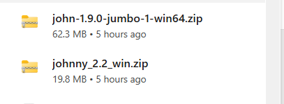
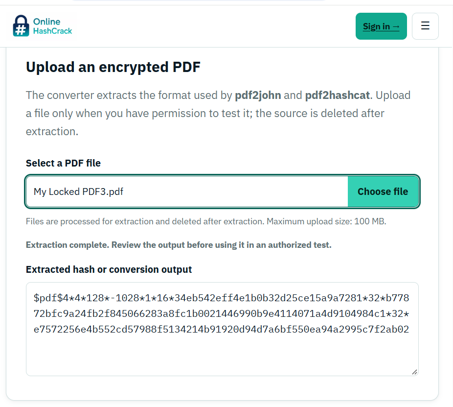
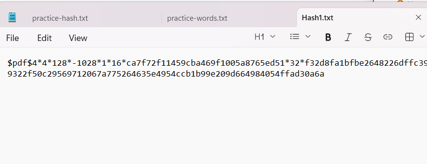
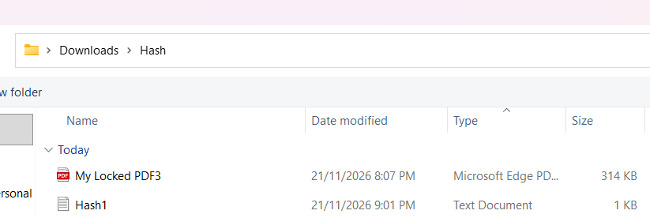
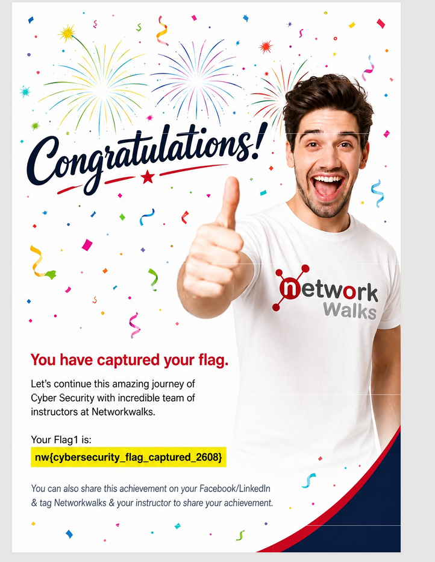

# Week 3 – Project Module 1: Password Cracking with JTR

**Internship:** NetworkWalks – Cybersecurity & Ethical Hacking  
**Module:** Week 3 – Project Module 1  
**Topic:** Password Cracking with John the Ripper  
**Operating System:** Windows  
**Tools Used:** John the Ripper (JTR), Johnny GUI, OnlineHashCrack PDF Hash Extractor, Notepad

---

## 1. Introduction

This lab focused on password cracking using John the Ripper (JTR) and its graphical user interface, Johnny. John the Ripper is a password auditing tool used to assess password security by testing possible passwords against stored password hashes.

The purpose of this exercise was to recover the password of a protected PDF document using John the Ripper and Johnny on a Windows computer.

The lab involved installing and configuring the required tools, extracting the hash from a password-protected PDF file, performing a password recovery attack, and using the recovered password to access the original document.

## 2. Objective

The objectives of this lab were to:

- Install John the Ripper on Windows.
- Install and configure Johnny GUI.
- Extract the password hash from the provided PDF document.
- Save the extracted hash in a text file.
- Load the extracted hash into Johnny.
- Perform a password recovery attack using JTR.
- Identify the recovered password.
- Use the recovered password to unlock the protected PDF document.

---

## 3. Practical Implementation

### Step 1: Downloading John the Ripper

The Windows version of John the Ripper was downloaded from the official Openwall website.

**Official Website:** https://www.openwall.com/john/

After downloading, the compressed folder was extracted, and the application files were prepared for use.

The `john.exe` executable was located inside the `run` directory.


*Figure 1: Downloading and preparing John the Ripper on Windows.*

### Step 2: Installing Johnny GUI

Johnny GUI was downloaded from the official Openwall website.

**Official Website:** https://openwall.info/wiki/john/johnny

The installation file was executed, and Johnny was successfully installed on the Windows computer.

Johnny provides a graphical interface that simplifies the use of John the Ripper by allowing users to manage password files, configure attacks, and view recovered passwords.



*Figure 2: Installation of Johnny GUI on Windows.*

### Step 3: Configuring John the Ripper in Johnny

After installation, Johnny was launched.

The **Settings** section was opened, and the **Browse** option was used to locate the `john.exe` executable inside the extracted John the Ripper folder.

The executable was selected to establish a connection between Johnny GUI and John the Ripper.

Johnny successfully detected the installed John the Ripper application, confirming that the configuration was completed.


*Figure 3: Configuring the John the Ripper executable in Johnny GUI.*

### Step 4: Preparing the Password-Protected PDF

The provided password-protected PDF document, **My Locked PDF1.pdf**, was downloaded and saved on the Windows computer.

The document was used as the target file for the password recovery exercise.


*Figure 4: Password-protected PDF document prepared for the lab.*

### Step 5: Extracting the PDF Password Hash

The OnlineHashCrack PDF Hash Extractor was accessed through the following website:

https://www.onlinehashcrack.com/tools-pdf-hash-extractor.php

The protected PDF document was selected using the Browse option and uploaded to the extractor.

After processing the document, the tool generated the corresponding PDF password hash.

The extracted hash began with the PDF hash identifier:

```text
$pdf$
```

This hash was required for the password recovery process using John the Ripper.



*Figure 5: Extracting the password hash from the protected PDF using OnlineHashCrack.*

### Step 6: Saving the Extracted Hash

The extracted PDF hash was copied from the online extractor.

Notepad was opened, and the hash value was pasted into a new text document.

The extracted content was checked to ensure that unnecessary characters were excluded and that the hash started with `$pdf$`.

The document was then saved as:

```text
hash1.txt
```

This file was used as the input password hash file for Johnny.



*Figure 6: Extracted PDF hash saved as hash1.txt using Notepad.*

### Step 7: Loading the Hash File into Johnny

Johnny GUI was opened, and the **Open password file** option was selected.

The previously created `hash1.txt` file was located and opened.

Johnny successfully loaded the extracted password hash for further analysis.

The hash format was configured appropriately for PDF password recovery.



*Figure 7: Loading the extracted PDF hash file into Johnny GUI.*

### Step 8: Starting the Password Recovery Attack

After loading the PDF hash, the **Start new attack** option was selected in Johnny.

Johnny initiated the password recovery process through John the Ripper.

During the attack, the software tested password candidates against the extracted PDF password-verification data.

The attack progress was monitored through Johnny until the password recovery process was completed.


*Figure 8: Password recovery attack initiated using Johnny GUI and John the Ripper.*

### Step 9: Recovering the PDF Password

After completing the attack, Johnny displayed the recovered password associated with the extracted PDF hash.

The recovered password was identified through the application's password results.

This demonstrated that John the Ripper successfully performed password recovery against the provided protected PDF document.


*Figure 9: Successfully recovered PDF password displayed in Johnny GUI.*

### Step 10: Unlocking the Protected PDF

The original password-protected PDF document was opened using a PDF reader.

When prompted for a password, the password recovered through Johnny was entered.

The password was accepted, and the document opened successfully.

This confirmed that the recovered password was correct and that the password recovery exercise had been completed.



*Figure 10: Successfully accessing My Locked PDF1.pdf using the recovered password.*

---

## 4. Results and Observations

The following results were obtained during the lab:

| Task | Result |
|---|---|
| Download and extraction of John the Ripper | Successful |
| Installation of Johnny GUI | Successful |
| Configuration of the JTR executable | Successful |
| Preparation of the protected PDF | Completed |
| PDF hash extraction | Successful |
| Saving the extracted hash | Completed |
| Loading the hash into Johnny | Successful |
| Password recovery attack | Completed |
| PDF password recovery | Successful |
| Opening the protected PDF | Successful |

The lab demonstrated the complete password recovery process, from obtaining password-verification data to accessing a protected document with the recovered password.

## 5. Security Observations

The practical exercise demonstrated several important password security concepts.

**Password strength:** The effectiveness of password protection depends partly on the complexity and unpredictability of the password selected.

**Password recovery:** John the Ripper can evaluate candidate passwords against extracted password-verification data to identify a matching password.

**Hash extraction:** Password-protected documents may contain verification information that can be extracted for authorized password auditing.

**Password protection:** A protected document may be vulnerable to password-guessing attacks if its password can be discovered using feasible candidate testing.

**Security awareness:** Strong and unique passwords are essential for protecting confidential documents against unauthorized access.

## 6. Conclusion

In this lab, I successfully completed the password recovery exercise using John the Ripper and Johnny GUI on Windows.

John the Ripper was downloaded and configured with Johnny, and the password hash was extracted from the provided password-protected PDF using OnlineHashCrack.

The extracted hash was saved in a text file and loaded into Johnny, where a password recovery attack was performed.

After recovering the password, I used it to open the protected PDF document successfully.

Overall, this practical exercise enhanced my understanding of password recovery techniques, password hash extraction, password security, and the use of John the Ripper and Johnny GUI in cybersecurity assessments.

---

**NetworkWalks Cybersecurity & Ethical Hacking Internship**  
**Week 3 – Project Module 1: Password Cracking with JTR**
